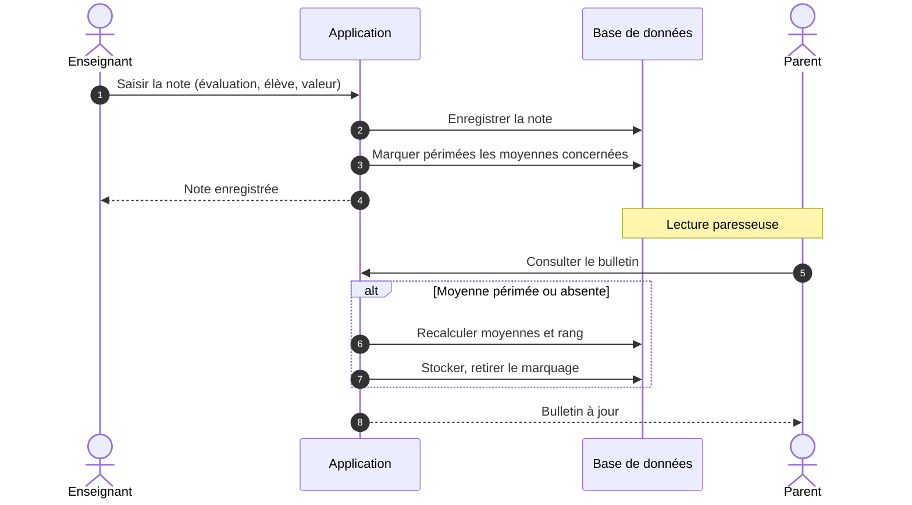

# Cahier des charges — Application de gestion scolaire (collèges et lycées privés, Cameroun)

## 1. Contexte et objectif

Application de gestion pour un établissement scolaire privé camerounais (de la 6e à la Terminale), destinée à être industrialisée ensuite comme produit multi-établissements. Version cible : périmètre complet (pas de MVP réduit), développée en 14 jours à l'aide d'une IA de codage, en Clean Architecture.

**Hors périmètre explicite** : aucun paiement en ligne — l'application ne fait que suivre le statut des paiements (attendu / versé / solde), les versements sont encaissés physiquement par l'administration.

## 2. Acteurs

Trois profils, un compte par personne :
- **Administration** (principal / surveillant général) — pilote l'établissement.
- **Enseignant** — agit sur ses classes et matières assignées.
- **Parent / tuteur** — consulte les informations de son ou ses enfants.

## 3. Fonctionnalités par profil

### 3.1 Administration
- Gestion des années scolaires (ouverture / clôture)
- Gestion des classes (niveau, section, capacité, enseignant principal)
- Inscriptions et réinscriptions des élèves, gestion des pièces du dossier
- Gestion des enseignants (matières, classes assignées)
- Suivi des paiements (frais attendus, versements, statut, reçus, annulation)
- Emploi du temps par classe
- Traitement des signalements enseignants → émission de convocations ou sanctions
- Publication des bulletins, période par période
- Statistiques (effectifs, taux de paiement, taux de réussite)

### 3.2 Enseignant
- Saisie des notes par évaluation (devoir, composition, interrogation), avec coefficients
- Gestion des absences et retards en cours
- Cahier de texte et devoirs (description, échéance)
- Signalement disciplinaire d'un élève à l'administration
- Consultation de son emploi du temps et de ses classes
- Consultation des moyennes et du classement de ses classes

### 3.3 Parent
- Tableau de bord par enfant (si plusieurs enfants dans l'établissement)
- Consultation des notes et bulletins (une fois publiés)
- Suivi de l'assiduité (absences, retards)
- Consultation des convocations et sanctions
- Consultation du cahier de texte et des devoirs
- Consultation du statut de paiement
- Notifications (convocation, nouvelle note, devoir, rappel de paiement)

## 4. Phases de développement (ordre de dépendance)

1. **Fondations** — authentification, rôles, années scolaires, classes, inscriptions
2. **Cœur enseignant** — notes, absences, cahier de texte / devoirs
3. **Cœur administration** — paiements, emploi du temps, signalements → convocations / sanctions
4. **Calcul et restitution** — moyennes, classements, bulletins, statistiques
5. **Espace parent complet** — agrégation des données ci-dessus + notifications

## 5. Modèle de données

| Entité | Champs clés | Relations |
|---|---|---|
| Établissement | nom, adresse, contact | racine de tout |
| AnnéeScolaire | libellé, dateDébut, dateFin, statut (ouverte/clôturée) | 1 établissement |
| Utilisateur | identifiant, motDePasseHash, rôle (admin/enseignant/parent) | 1 établissement |
| Parent | lié à Utilisateur | plusieurs élèves |
| Élève | nom, prénom, dateNaissance | plusieurs parents |
| Classe | niveau, section, année scolaire, capacité, enseignant principal | 1 année scolaire |
| Inscription | élève, classe, année scolaire, statut (inscrit/redoublant/transféré) | pivot élève↔classe, porte l'historique |
| Document | type (acte de naissance, bulletin précédent...), statut (fourni/manquant), fichier | 1 inscription |
| Enseignant | lié à Utilisateur, matières, classes assignées | — |
| Matière | nom, coefficient par classe | — |
| Période | libellé (trimestre), dateDébut, dateFin, statut (ouverte/clôturée), bulletinsPubliés (bool) | 1 année scolaire |
| Évaluation | type, matière, classe, période, coefficient | — |
| Note | inscription, évaluation, valeur (nullable), statut (saisie/absent) | historisée |
| HistoriqueNote | note, ancienneValeur, date, auteur | 1 note |
| Absence | inscription, date, cours, justifiée (bool) | — |
| Devoir | classe, matière, enseignant, description, échéance | — |
| Signalement | inscription, enseignant, motif, statut (en attente/traité), lien optionnel vers convocation/sanction | — |
| Convocation/Sanction | inscription, type, motif, date, durée (optionnel), émetteur | — |
| Notification | destinataire, type, statut (envoyée/échec/réessai), luLe (nullable) | — |
| Paiement (Versement) | inscription, montantAttendu, montantVersé, mode, référence, date, statut (partiel/soldé), annulé (bool) | — |
| MoyenneCalculée | inscription, portée (matière/trimestre/année), période, valeur, rang, périmée (bool), calculéeLe | pré-agrégée, recalcul paresseux |

**Règle de calcul** : les notes ne déclenchent qu'un marquage `périmée = true` sur les moyennes concernées. Le recalcul se fait à la première lecture qui suit (bulletin, classement), jamais à la saisie — évite de recalculer à chaque note posée en rafale.

**Règle de publication** : les bulletins d'une période ne sont visibles côté parent que lorsque l'administration bascule `bulletinsPubliés = true` pour cette période.

## 6. Diagrammes de séquence de référence

Quatre scénarios ont été validés (nominal / exception / erreur) : saisie de note, inscription d'un élève, convocation, paiement. Extrait représentatif — saisie de note :

Les diagrammes complets (nominal, exception, erreur, pour chacun des 4 scénarios) sont déjà générés en fichiers `.mermaid` séparés dans cette conversation ; les reprendre tels quels pour l'implémentation des cas limites (permissions, période clôturée, doublons, pannes d'écriture, notifications en échec).

## 7. Exigences non fonctionnelles

**Sécurité**
- Authentification par rôle, autorisation stricte au niveau de chaque ressource (un enseignant n'agit que sur ses classes assignées, un parent ne voit que ses enfants)
- Mots de passe hashés (bcrypt/argon2), jamais en clair
- Traçabilité des actions sensibles (qui a saisi/modifié une note, qui a émis une sanction)
- Cloisonnement des données par établissement (le modèle multi-tenant doit empêcher toute fuite entre établissements)

**Robustesse et fiabilité**
- Toute opération multi-écriture (ex. création élève + parent + inscription) doit être transactionnelle : tout ou rien
- Validation systématique des entrées côté serveur, jamais seulement côté client
- Aucune perte de donnée en cas de panne pendant une écriture (rollback propre, message d'erreur clair à l'utilisateur)

**Fonctionnement hors ligne (offline-first)**
- Contrainte critique compte tenu des coupures réseau/électricité fréquentes au Cameroun
- Les actions de saisie côté enseignant (notes, absences, devoirs) doivent pouvoir être effectuées sans connexion et mises en file d'attente locale, synchronisées dès que le réseau revient
- Stratégie de résolution de conflits à définir en priorité pour la phase 2 (ex. dernière écriture gagnante avec horodatage, ou verrouillage par évaluation)
- Les consultations côté parent doivent pouvoir afficher la dernière donnée synchronisée avec un indicateur clair de fraîcheur ("à jour" / "hors ligne, dernière synchro à...")

**Scalabilité**
- Le modèle multi-établissement dès la conception (clé étrangère établissement partout) permet d'ajouter des clients sans refonte
- Séparer clairement lecture (bulletins, statistiques) et écriture pour absorber la charge de fin de trimestre

## 8. Architecture recommandée — Clean Architecture

Quatre couches, dépendances pointant toujours vers le centre :

1. **Domaine** (entités, règles métier pures — ex. calcul de moyenne, règles de recalcul paresseux) — aucune dépendance technique
2. **Cas d'usage / Application** (ex. `SaisirNote`, `InscrireÉlève`, `PublierBulletins`) — orchestrent le domaine, définissent des interfaces (ports) vers la persistance et les notifications
3. **Interfaces / Adaptateurs** (contrôleurs API, présentateurs, mappers) — traduisent entre le monde extérieur et les cas d'usage
4. **Infrastructure** (base de données, file d'attente offline, service de notification) — implémente les ports définis en couche 2

Cette séparation permet notamment d'implémenter la synchronisation offline comme un adaptateur remplaçable, sans toucher au domaine ni aux cas d'usage.

## 9. Stack technique retenu

- **Backend** : NestJS + PostgreSQL, structuré selon les quatre couches de la Clean Architecture (domaine, cas d'usage, adaptateurs, infrastructure)
- **Frontend web (administration et enseignant)** : Next.js — usage principalement en établissement, où la connexion est plus stable
- **Application parent** : mobile, React Native/Expo — plus adaptée à un usage nomade en zone de réseau instable
- **Offline** : limité à la consultation en lecture seule côté parent (base locale SQLite + file de données synchronisées, avec indicateur de fraîcheur "à jour" / "hors ligne, dernière synchro à..."). Pas de saisie hors ligne côté enseignant dans cette première version — la saisie se fait en établissement où le réseau est généralement disponible, ce qui évite la complexité de résolution de conflits en phase 1

## 10. Périmètre de la phase 1 (à démarrer immédiatement)

Authentification + rôles, entités Établissement / AnnéeScolaire / Classe / Inscription / Élève / Parent, avec les règles de sécurité et le cloisonnement multi-établissement posés dès le départ, car ils sont plus coûteux à ajouter après coup.
